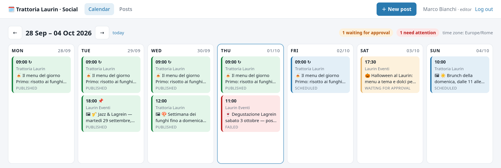
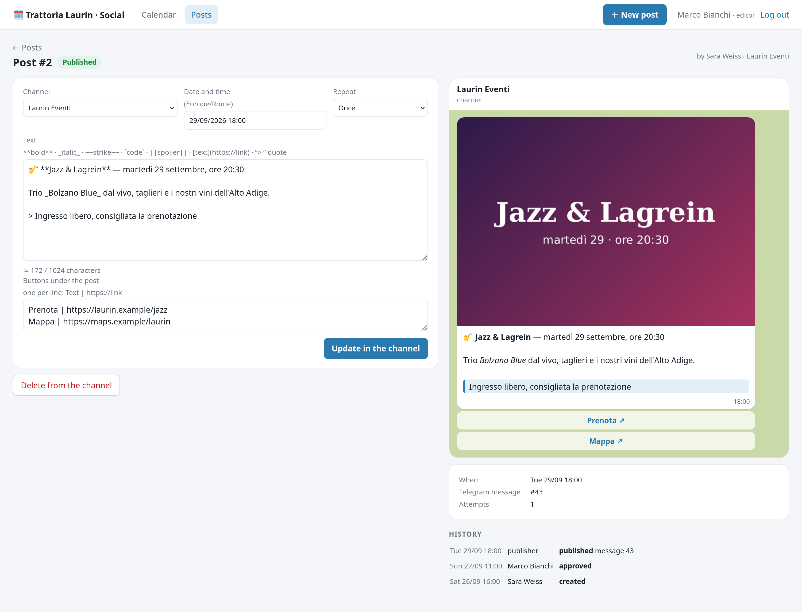
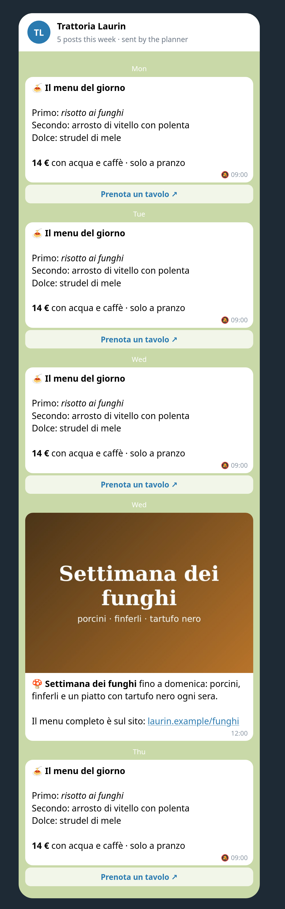

# 🗓️ Post Planner

<p>
  <a href="https://github.com/sonoyumi/post-planner/actions/workflows/ci.yml"></a>
  
  
  
  
  
</p>

**🇬🇧 [English](#en)** · **🇮🇹 [Italiano](#it)** · **🇺🇦 [Українська](#uk)** · **🇷🇺 [Русский](#ru)**

<p align="center">
  
</p>
<p align="center">
  
  
</p>

---

<a id="en"></a>

## 🇬🇧 English

A content planner for Telegram channels. The team writes posts in a web panel, an editor approves them, and the
publisher sends them at the right time — with photos, buttons, pinning, repeats and without double posts. Built for
small businesses and agencies that run one or many channels: a restaurant with a daily menu, a shop with offers, an
event venue.

```
author: draft ──send for approval──► editor: approve & schedule (local time, DST-safe) ──► scheduled
                                       └─ return with a note ─► draft
publisher (every 2 s): claim with a lease ─► Telegram ─► published ─► pin · next run of a repeating post
                          ├─ flood control → wait exactly retry_after      ├─ bot removed → failed (reason shown)
                          └─ network / 5xx → retry 30 s, 60 s, 120 s…      └─ crash while sending → "check the channel"
```

### Features

- **Writing:** simple markup — `**bold**`, `_italic_`, `~~strike~~`, `` `code` ``, `||spoiler||`, `[text](url)`, `> quote` —
  turned into Telegram HTML; everything else is escaped. A Telegram-like preview with the photo and buttons. Length is
  counted the way Telegram does (UTF-16; 4096 for a post, 1024 for a photo caption) before the post can be approved.
- **Team and roles:** authors write and send for approval; editors approve, return with a note, schedule, publish now;
  admins add channels (the bot's admin rights are checked) and users. Every action is in the post's history.
- **Calendar:** the week by day, in the team's time zone; posts coloured by status; counters for what waits for approval
  and what needs attention.
- **Time done right:** dates typed the European way (`05/10/2026 09:00`); a time that does not exist when the clocks jump
  forward is refused; a post repeated every day / on weekdays / every week stays at 9:00 local time after the change.
- **Reliable publishing:** a lease per post; Telegram's flood control waits exactly as long as asked; temporary errors are
  retried with growing pauses; permanent ones (bot removed, chat not found, text refused) fail at once with a clear
  reason and a «try again» button. **At most once:** if the process dies while sending, the post is marked «check the
  channel» instead of being sent twice — a person presses «it is there» or «send again».
- **After publishing:** edit the text and buttons in the channel, delete from the channel, pin without notifying.
- **Photos:** JPG, PNG or WEBP, re-encoded to a clean JPEG (camera data and GPS removed).
- **Optional AI help:** shorter, friendlier, more formal, fix spelling, translate to IT/EN/DE/UK — shown as a suggestion,
  never applied by itself; no invented facts; a daily limit.
- **Security:** scrypt passwords, signed session cookie, CSRF on every form, login attempts limit, strict CSP, photos only
  for logged-in users.

### Example

```bash
post-planner stats
```

```
draft: 1 · pending: 1 · scheduled: 2 · published: 6 · failed: 1
  ⚠️  #4 Laurin Eventi: failed — the bot is not an administrator of this channel any more: add it back, then “Try again now”
```

Real output after the demo week shown in the screenshots: the panel, the publisher and the Telegram client code ran for
real; only the connection to Telegram was replaced by a recorder, so «the channel» on the right is exactly what Telegram
would have received. The restaurant and the posts are fictional.

### Quick start

```bash
git clone https://github.com/sonoyumi/post-planner.git
cd post-planner
python3 -m venv .venv && source .venv/bin/activate
pip install -e ".[dev]"
cp .env.example .env                      # SECRET_KEY, BOT_TOKEN, TIMEZONE
post-planner add-user --email you@shop.it --name "Your Name" --role admin
post-planner add-channel @your_channel    # the bot must be an admin who can post
post-planner serve                        # panel + publisher on http://127.0.0.1:8095
```

Other commands: `publisher` (separate process), `check` (token and channel rights), `stats`, `passwd EMAIL`.
Docker: `docker build -t post-planner . && docker run -p 8095:8095 --env-file .env -v $PWD/data:/app/data post-planner`.

Tests: `pytest` (35 tests: markup and escaping, Telegram length rules, buttons, time zones and daylight saving, repeats,
the publisher with flood control, network errors, removed bots, crashes while sending and failed pins, the panel end to
end with roles, approval, returning, scheduling rules, photos, live edits and deletes, AI suggestions and limits, the
command line). No network and no bot token needed.

### Project structure

```
src/post_planner/
├── config.py      # settings from .env, every error at once
├── formatting.py  # markup -> Telegram HTML, length rules, buttons, preview
├── schedule.py    # local time <-> UTC, daylight saving, repeats, weeks
├── store.py       # SQLite: users, channels, posts, life cycle, history, AI budget
├── telegram.py    # Bot API calls and error sorting (aiogram)
├── publisher.py   # sends due posts: lease, retries, at most once, repeats, pins
├── ai.py          # optional rewriting with Claude (structured output)
├── web.py         # the panel: FastAPI + Jinja2
└── cli.py         # add-user | passwd | add-channel | serve | publisher | check | stats
```

### Author

**Vladyslav Shokun** ([@sonoyumi](https://github.com/sonoyumi)), Python developer: Telegram bots, web scraping, automation.

[](https://t.me/sonoyumiii)
[](mailto:sonoyumiii@gmail.com)
[](https://www.linkedin.com/in/vladyslav-shokun/)

> 💼 Your Telegram channel lives on «someone posts when they remember»? I'll set up a planner like this for your team.

### License

MIT, see [LICENSE](LICENSE).

---

<a id="it"></a>

## 🇮🇹 Italiano

**[🇬🇧 English](#en)** · **🇮🇹 Italiano** · **[🇺🇦 Українська](#uk)** · **[🇷🇺 Русский](#ru)**

Un planner di contenuti per i canali Telegram. Il team scrive i post in un pannello web, un editor li approva e il
pubblicatore li invia all'ora giusta — con foto, pulsanti, fissaggio, ripetizioni e senza post doppi. Pensato per piccole
attività e agenzie con uno o più canali: un ristorante con il menu del giorno, un negozio con le offerte, un locale con
gli eventi.

### Funzionalità

- **Scrittura:** formattazione semplice (`**grassetto**`, `_corsivo_`, `||spoiler||`, `[testo](url)`, `> citazione`)
  trasformata in HTML di Telegram; tutto il resto è testo. Anteprima come in Telegram con foto e pulsanti; lunghezza
  contata come Telegram (4096 per un post, 1024 per la didascalia di una foto).
- **Team e ruoli:** gli autori scrivono e inviano in approvazione; gli editor approvano, rimandano con una nota,
  programmano, pubblicano subito; gli admin aggiungono canali (i permessi del bot vengono verificati) e utenti.
  Ogni azione resta nello storico.
- **Calendario** della settimana nel fuso orario del team; colori per stato; contatori di cosa aspetta approvazione e
  cosa richiede attenzione.
- **Orari corretti:** date all'europea (`05/10/2026 09:00`); un orario che non esiste al cambio dell'ora viene
  rifiutato; un post ripetuto ogni giorno / nei giorni feriali / ogni settimana resta alle 9:00 anche dopo il cambio.
- **Pubblicazione affidabile:** il controllo anti-flood di Telegram viene rispettato al secondo; errori temporanei
  riprovati con pause crescenti; quelli permanenti (bot rimosso, testo rifiutato) mostrati subito con il motivo.
  **Al massimo una volta:** se il processo si ferma durante l'invio, il post diventa «controlla il canale» invece di
  essere inviato due volte.
- **Dopo la pubblicazione:** modificare testo e pulsanti nel canale, eliminare dal canale, fissare in silenzio.
- **Foto** ricodificate in JPEG pulito (senza dati della fotocamera e GPS).
- **IA facoltativa:** più breve, più cordiale, più formale, correggi, traduci — solo come suggerimento, con limite giornaliero.
- **Sicurezza:** password scrypt, cookie firmato, CSRF, limite di tentativi di accesso, CSP.

### Esempio

Gli screenshot in alto vengono da una settimana dimostrativa reale: pannello, pubblicatore e codice del client Telegram
sono stati eseguiti davvero; solo la connessione a Telegram è stata sostituita da una registrazione, quindi «il canale»
a destra è esattamente ciò che Telegram avrebbe ricevuto. Ristorante e post sono inventati.

### Avvio rapido

```bash
git clone https://github.com/sonoyumi/post-planner.git
cd post-planner
python3 -m venv .venv && source .venv/bin/activate
pip install -e ".[dev]"
cp .env.example .env                      # SECRET_KEY, BOT_TOKEN, TIMEZONE
post-planner add-user --email voi@negozio.it --name "Nome" --role admin
post-planner add-channel @vostro_canale
post-planner serve                        # pannello su http://127.0.0.1:8095
```

Test: `pytest` (35 test, senza rete e senza token).

### Struttura del progetto

Vedi la sezione inglese: `formatting.py` (testo), `schedule.py` (orari), `store.py` (SQLite), `telegram.py` (Bot API),
`publisher.py` (pubblicazione), `ai.py` (IA), `web.py` (pannello), `cli.py` (comandi).

### Autore

**Vladyslav Shokun** ([@sonoyumi](https://github.com/sonoyumi)), sviluppatore Python: bot Telegram, web scraping, automazione.

[](https://t.me/sonoyumiii)
[](mailto:sonoyumiii@gmail.com)
[](https://www.linkedin.com/in/vladyslav-shokun/)

> 💼 Il vostro canale Telegram vive di «qualcuno pubblica quando se ne ricorda»? Preparo un planner come questo per il vostro team.

### Licenza

MIT, vedi [LICENSE](LICENSE).

---

<a id="uk"></a>

## 🇺🇦 Українська

**[🇬🇧 English](#en)** · **[🇮🇹 Italiano](#it)** · **🇺🇦 Українська** · **[🇷🇺 Русский](#ru)**

Планувальник контенту для Telegram-каналів. Команда пише пости у вебпанелі, редактор затверджує, а публікатор
відправляє їх у потрібний час — з фото, кнопками, закріпленням, повторами й без подвійних постів. Для малого бізнесу
й агенцій з одним чи кількома каналами: ресторан із меню дня, магазин з акціями, заклад з подіями.

### Можливості

- **Написання:** проста розмітка (`**жирний**`, `_курсив_`, `||спойлер||`, `[текст](url)`, `> цитата`) перетворюється
  на HTML Telegram, усе інше екранується. Прев'ю як у Telegram з фото й кнопками; довжина рахується як у Telegram
  (4096 для поста, 1024 для підпису до фото).
- **Команда й ролі:** автори пишуть і надсилають на затвердження; редактори затверджують, повертають із коментарем,
  планують, публікують одразу; адміни додають канали (права бота перевіряються) і користувачів. Кожна дія — в історії.
- **Календар** тижня в часовому поясі команди; кольори за статусом; лічильники «чекає затвердження» і «потребує уваги».
- **Правильний час:** дати по-європейськи (`05/10/2026 09:00`); неіснуючий при переведенні годинника час
  відхиляється; пост «щодня / по буднях / щотижня» лишається о 9:00 місцевого часу.
- **Надійна публікація:** flood control Telegram дотримується до секунди; тимчасові помилки — повтори з паузами;
  постійні (бота прибрали, текст відхилено) — одразу з причиною. **Не більше одного разу:** якщо процес упав під час
  відправлення, пост позначається «перевірте канал», а не відправляється вдруге.
- **Після публікації:** змінити текст і кнопки в каналі, видалити з каналу, закріпити без сповіщення.
- **Фото** перекодовуються в чистий JPEG (без даних камери й GPS).
- **ШІ за бажанням:** коротше, тепліше, офіційніше, виправити, перекласти — лише як пропозиція, з денним лімітом.
- **Безпека:** паролі scrypt, підписаний cookie, CSRF, ліміт спроб входу, CSP.

### Приклад

Скриншоти вгорі — зі справжнього демо-тижня: панель, публікатор і код клієнта Telegram працювали насправді; лише
з'єднання з Telegram замінено записом, тож «канал» праворуч — це саме те, що отримав би Telegram. Ресторан і пости
вигадані.

### Швидкий старт

```bash
git clone https://github.com/sonoyumi/post-planner.git
cd post-planner
python3 -m venv .venv && source .venv/bin/activate
pip install -e ".[dev]"
cp .env.example .env                      # SECRET_KEY, BOT_TOKEN, TIMEZONE
post-planner add-user --email you@shop.it --name "Ім'я" --role admin
post-planner add-channel @your_channel
post-planner serve                        # панель на http://127.0.0.1:8095
```

Тести: `pytest` (35 тестів, без мережі й токена).

### Структура проєкту

Див. англійський розділ: `formatting.py` (текст), `schedule.py` (час), `store.py` (SQLite), `telegram.py` (Bot API),
`publisher.py` (публікація), `ai.py` (ШІ), `web.py` (панель), `cli.py` (команди).

### Автор

**Vladyslav Shokun** ([@sonoyumi](https://github.com/sonoyumi)), Python-розробник: Telegram-боти, вебскрапінг, автоматизація.

[](https://t.me/sonoyumiii)
[](mailto:sonoyumiii@gmail.com)
[](https://www.linkedin.com/in/vladyslav-shokun/)

> 💼 Ваш Telegram-канал живе за принципом «хтось опублікує, коли згадає»? Налаштую такий планувальник для вашої команди.

### Ліцензія

MIT, див. [LICENSE](LICENSE).

---

<a id="ru"></a>

## 🇷🇺 Русский

**[🇬🇧 English](#en)** · **[🇮🇹 Italiano](#it)** · **[🇺🇦 Українська](#uk)** · **🇷🇺 Русский**

Планировщик контента для Telegram-каналов. Команда пишет посты в веб-панели, редактор утверждает, а публикатор
отправляет их в нужное время — с фото, кнопками, закреплением, повторами и без двойных постов. Для малого бизнеса и
агентств с одним или несколькими каналами: ресторан с меню дня, магазин с акциями, заведение с событиями.

### Возможности

- **Написание:** простая разметка (`**жирный**`, `_курсив_`, `||спойлер||`, `[текст](url)`, `> цитата`) превращается в
  HTML Telegram, всё остальное экранируется. Превью как в Telegram с фото и кнопками; длина считается как в Telegram
  (4096 для поста, 1024 для подписи к фото).
- **Команда и роли:** авторы пишут и отправляют на утверждение; редакторы утверждают, возвращают с комментарием,
  планируют, публикуют сразу; админы добавляют каналы (права бота проверяются) и пользователей. Каждое действие — в
  истории.
- **Календарь** недели в часовом поясе команды; цвета по статусу; счётчики «ждёт утверждения» и «требует внимания».
- **Правильное время:** даты по-европейски (`05/10/2026 09:00`); несуществующее при переводе часов время отклоняется;
  пост «каждый день / по будням / каждую неделю» остаётся в 9:00 местного времени.
- **Надёжная публикация:** flood control Telegram соблюдается до секунды; временные ошибки — повторы с паузами;
  постоянные (бота убрали, текст отклонён) — сразу с причиной. **Не больше одного раза:** если процесс упал во время
  отправки, пост помечается «проверьте канал», а не отправляется повторно.
- **После публикации:** изменить текст и кнопки в канале, удалить из канала, закрепить без уведомления.
- **Фото** перекодируются в чистый JPEG (без данных камеры и GPS).
- **ИИ по желанию:** короче, теплее, официальнее, исправить, перевести — только как предложение, с дневным лимитом.
- **Безопасность:** пароли scrypt, подписанный cookie, CSRF, лимит попыток входа, CSP.

### Пример

Скриншоты вверху — с настоящей демо-недели: панель, публикатор и код клиента Telegram работали по-настоящему; только
соединение с Telegram заменено записью, поэтому «канал» справа — ровно то, что получил бы Telegram. Ресторан и посты
вымышленные.

### Быстрый старт

```bash
git clone https://github.com/sonoyumi/post-planner.git
cd post-planner
python3 -m venv .venv && source .venv/bin/activate
pip install -e ".[dev]"
cp .env.example .env                      # SECRET_KEY, BOT_TOKEN, TIMEZONE
post-planner add-user --email you@shop.it --name "Имя" --role admin
post-planner add-channel @your_channel
post-planner serve                        # панель на http://127.0.0.1:8095
```

Тесты: `pytest` (35 тестов, без сети и токена).

### Структура проекта

См. английский раздел: `formatting.py` (текст), `schedule.py` (время), `store.py` (SQLite), `telegram.py` (Bot API),
`publisher.py` (публикация), `ai.py` (ИИ), `web.py` (панель), `cli.py` (команды).

### Автор

**Vladyslav Shokun** ([@sonoyumi](https://github.com/sonoyumi)), Python-разработчик: Telegram-боты, веб-скрапинг, автоматизация.

[](https://t.me/sonoyumiii)
[](mailto:sonoyumiii@gmail.com)
[](https://www.linkedin.com/in/vladyslav-shokun/)

> 💼 Ваш Telegram-канал живёт по принципу «кто-нибудь опубликует, когда вспомнит»? Настрою такой планировщик для вашей команды.

### Лицензия

MIT, см. [LICENSE](LICENSE).
